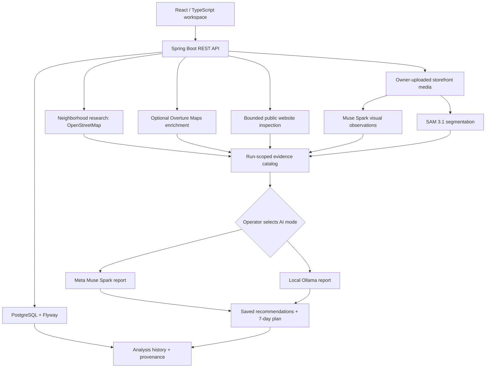

# S4 Neighborhood Intelligence

**See your neighborhood. Understand your competition. Know your next move.**

**Evidence-aware neighborhood research and practical action planning for local businesses.**

S4 Neighborhood Intelligence is a local-first web application that helps a small-business operator answer a concrete question: **“What should I improve to attract more customers, and what evidence supports that decision?”**

Rather than asking an AI model to guess what competitors are doing, S4 collects a bounded set of observable signals, keeps track of their sources, and generates a prioritized action plan with explicit limitations. The user can inspect storefront imagery, review nearby places and public websites, reopen prior analyses, and see which AI model operations were newly performed or reused.

Developed for the **Meta Global AI Developer Hackathon (2026)**, under the *Build for Your World* theme. The project is a working local prototype, **not a production-deployed competitive-intelligence service**.

## See S4 in action

A typical business-owner workflow:

1. **Set the goal.** Choose a business, the services to focus on, and a practical goal such as attracting more local customers.
2. **Investigate the area.** S4 discovers nearby businesses and inspects permitted public website content, preserving where each observation came from.
3. **Inspect the storefront.** With the owner's consent, Muse Spark examines an uploaded JPEG, PNG or MP4, while SAM 3.1 can identify candidate regions such as storefront signage.
4. **Review the decisions.** The analysis produces three suggested opportunities and a seven-day action plan, with cited sources, uncertainty and measurements to try.
5. **Audit and revisit.** The owner can inspect the original media, segmentation overlay, AI model execution records, and past analysis reports.

**Demo evidence:** A saved local test recorded a new Muse Spark recommendation response alongside previously saved Muse storefront observations and SAM segmentation. The interface explicitly distinguishes new model operations from reused results. A single fresh end-to-end run of every model has not yet been established by this evidence.

## The problem

A small-business owner often lacks the time or expertise to compare nearby listings, read multiple business websites, evaluate storefront visibility, and turn those observations into realistic next steps. Generic AI recommendations can be persuasive even when they lack evidence. S4 is designed to make those recommendations **specific, inspectable, and appropriately cautious**.

## What the application does

| Capability | Current implementation |
| --- | --- |
| Business workspace | Register/sign in, create or edit a business profile, and select a business goal and focus services. |
| Neighborhood discovery | Geocoding and nearby-place discovery using OpenStreetMap services, with optional Overture Maps place enrichment. |
| Website research | Bounded inspection of publicly accessible business homepages and selected detail pages; records skipped or inaccessible pages rather than fabricating content. |
| Storefront inspection | Owner-provided JPEG, PNG or MP4 analyzed using **Muse Spark** through the **Meta Model API**, when enabled. |
| Storefront segmentation | Optional **SAM 3.1** concept-based region detection, with a visual overlay and an explicitly suggested sign-focused view. |
| One-click analysis | Coordinates local research, optional visual analysis, and a cited report that contains three opportunities and a seven-day plan. |
| Model selection | An opt-in Meta-powered path, or a local **Ollama** report path using `qwen2.5:7b` by default. |
| Evidence transparency | Source IDs, observed vs. contextual vs. owner-provided evidence, known limitations, and rule-based suggested action order. |
| Saved history | Persisted run statuses and reports; reopen earlier results without regenerating them; guarded single/bulk history deletion. |
| Model provenance | Displays saved model names, response IDs when available, and whether a result was newly recorded, reused, missing, or unverified. |

**What it does not claim:** S4 does not independently know competitor revenue, bookings, foot traffic, customer satisfaction, or marketing ROI. Public listings are not proof that a business offers or lacks a service. Recommendations are hypotheses for the operator to test, not measured financial outcomes.

## How the Meta models contribute

1. **Muse Spark (`muse-spark-1.3` by default)** examines a supplied storefront image and records visual observations. This is a distinct operation from writing the business report.
2. **SAM 3.1 (`sam-3.1` by default)** segments candidate regions corresponding to a requested concept such as `storefront sign`. The displayed sign-focused region is a heuristic suggestion; it does not independently verify the mask's accuracy.
3. **Muse Spark** turns the gathered evidence catalog into exactly three proposed opportunities and a seven-day action plan. Each item references source IDs and describes uncertainty, effort, and a measurement to try.

The interface exposes the recorded provenance for each operation. **A saved result completed before the current run is marked as reused; opening history does not prove another API request occurred.** Meta usage is opt-in and can consume Model API credits. When Meta is disabled, the local Ollama path does not call the Meta API for report generation.

## Project status and boundaries

**Current status:** Functional local hackathon prototype. It is not hosted as a production service, and outputs are recommendations to verify rather than measured business results.

**Not part of the demonstrated core workflow:** Automatically generated storefront before-and-after improvement images, post-action outcome tracking, and an unrestricted natural-language agent instruction field. These are potential later additions, not features claimed as implemented here.

The app does not guarantee increases in customer traffic, sales, or rankings. A storefront detection score is a model estimate, not independent proof that a mask is accurate.

## Architecture



**Stack:** Java 21, Spring Boot 4.1.2, Spring Data JPA, PostgreSQL, Flyway, Spring Security, React 19, TypeScript 6, Vite 8, React Router, React Leaflet, Tailwind CSS, and Oxlint.

### Repository layout

```text
backend/
  src/main/java/com/s4/neighborhood/
    client/         # Meta, Ollama, OpenStreetMap integrations
    controller/     # Authenticated REST endpoints
    dto/            # Request and response contracts
    entity/         # Persisted business, run, media and evidence records
    repository/     # Spring Data access
    security/       # Session auth, access checks, rate limiting
    service/        # Research, orchestration, evidence and ranking
  src/main/resources/db/migration/  # Flyway migrations V1–V16
  src/test/         # Backend test suite
frontend/
  src/app/          # Authentication and application shell
  src/features/     # Business, neighborhood, storefront, analysis and evidence views
  src/services/     # API clients
  public/           # UI assets and custom icons
```

## Run locally (Windows / PowerShell)

### Requirements

- Java 21 JDK
- Node.js with npm (use a version compatible with the included Vite 8 toolchain)
- PostgreSQL (the project has been developed with PostgreSQL 18)
- An existing PostgreSQL database named `s4_neighborhood_intelligence` and login role `s4_neighborhood_app`, with a password and the permissions required for Flyway migrations
- An OpenStreetMap-compatible contact-bearing User-Agent for live neighborhood requests
- **Optional:** Ollama with `qwen2.5:7b` for local reports
- **Optional:** a valid Meta Model API key for paid/credit-backed Meta reports, visual inspection and SAM segmentation
- **Optional:** the `overturemaps` command-line utility for extra local place candidates. If unavailable, the app can still use its OpenStreetMap research path.

The application expects a **pre-created PostgreSQL database and role**. Flyway will apply the schema migrations at startup. Do not point S4 at an unrelated database.

### 1. Configure the backend terminal

Clone the project and enter its folder if you have not already done so:

```powershell
git clone https://github.com/SantoshAdhikar/s4-neighborhood-intelligence.git
cd s4-neighborhood-intelligence
```

From the repository root, open **PowerShell** and run:

```powershell
cd backend

# Enter your existing database password without displaying it.
$secret = Read-Host "S4 PostgreSQL app password" -AsSecureString
$ptr = [Runtime.InteropServices.Marshal]::SecureStringToBSTR($secret)
try {
    $env:S4_DB_PASSWORD = [Runtime.InteropServices.Marshal]::PtrToStringBSTR($ptr)
} finally {
    [Runtime.InteropServices.Marshal]::ZeroFreeBSTR($ptr)
}
Remove-Variable secret, ptr -ErrorAction SilentlyContinue

# Supply your application's own identifying User-Agent, including a real contact address.
$env:S4_OSM_USER_AGENT = Read-Host "OpenStreetMap User-Agent (application and contact)"
```

For the **Meta-enabled path only**, enter the Model API key in that same terminal:

```powershell
$secret = Read-Host "Meta Model API key" -AsSecureString
$ptr = [Runtime.InteropServices.Marshal]::SecureStringToBSTR($secret)
try {
    $env:MODEL_API_KEY = [Runtime.InteropServices.Marshal]::PtrToStringBSTR($ptr).Trim()
} finally {
    [Runtime.InteropServices.Marshal]::ZeroFreeBSTR($ptr)
}
Remove-Variable secret, ptr -ErrorAction SilentlyContinue
```

The variables above apply to the **current PowerShell process**. Restarting a new terminal means you must set them again. Never commit keys, passwords, or `.env` files to GitHub.

### 2. Backend tests and startup

```powershell
.\mvnw.cmd clean test
.\mvnw.cmd spring-boot:run
```

The backend listens at `http://127.0.0.1:8080`. A health check is available at `http://127.0.0.1:8080/actuator/health`.

### 3. Frontend

Open a **second** PowerShell terminal in the repository root:

```powershell
cd frontend
npm ci
npm run lint
npm run build
npm run dev
```

Open **`http://localhost:5173`**. Vite proxies `/api` requests to the local Spring Boot backend.

### 4. Local report mode (without Meta API usage)

Install and run Ollama, then ensure the default model is present:

```powershell
ollama list
ollama pull qwen2.5:7b  # Only if it is not already installed
```

Keep Ollama's local server available at `127.0.0.1:11434` and leave the **Meta AI** option unchecked when starting an analysis. A local report still requires the backend, database, and available evidence; it cannot invent missing visual observations.

## Typical workflow

1. Sign in and open or create a business profile.
2. Select the business goal, relevant services, public HTTPS website, and optional customer feedback.
3. Upload a storefront image if visual research is needed. Choose **Meta AI** and optionally **SAM sign segmentation** to permit the corresponding external requests.
4. Start complete analysis. Follow research, website, visual, segmentation and report stages.
5. Inspect three opportunities, their evidence and suggested action order, and the seven-day plan.
6. Expand competitor research and **AI Model Evidence** to audit inputs and provenance.
7. Open **Analysis History** to revisit the saved result. Deletion requires confirmation and is restricted for active runs; media referenced by saved analysis runs is protected from deletion.

## Evidence and safety boundaries

- Business and neighborhood observations are linked to source records. Citation presence does **not** prove an inference is correct; users should open the source and verify it.
- Website inspections are bounded and do not scrape private reviews. A missing or blocked page is recorded as unavailable rather than treated as a negative finding.
- Owner-supplied feedback is unverified; it is not presented as a representative survey or review dataset.
- Saved model response IDs support provenance, but the SAM mask and model-generated visual descriptions still require human inspection.
- The backend binds to `127.0.0.1` for local use. **Do not expose this build on a public server without an independent security, privacy, operations and deployment review.**
- Media is stored outside the Git repository by default under the user's home directory.
- AI requests may fail because of API permissions, credits, timeouts or model errors. Partial research can remain saved while the run is marked failed.

## Tests and current verification scope

The repository includes unit and integration tests for analysis orchestration, model response handling, evidence and source constraints, business authorization and storefront workflows. Run `mvnw.cmd clean test`, `npm run lint`, and `npm run build` on your own machine before publishing a new version.

During local development, the owner-facing workflow has been exercised with a real business example. Saved model-provenance records have shown a Muse Spark recommendation response together with previously generated Muse inspection and SAM segmentation results. **That does not establish that every model ran anew in the same analysis.** The final recorded demonstration should disclose exactly what was newly generated and what was reused.

## What to review in the hackathon demo

- **The question:** Why might nearby customers overlook a real small business?
- **The evidence:** Show the neighborhood results, public website findings, actual storefront image, and saved SAM overlay.
- **The Meta contribution:** Open **AI Model Evidence** and identify which Muse Spark and SAM 3.1 responses were new versus reused, with the recorded model names and response IDs.
- **The decision:** Explain one concrete opportunity, its supporting and contradictory evidence, and the seven-day task designed to test it.
- **The limits:** Explain what S4 cannot know from public sources, and which model observations need visual confirmation.

Screenshots, a video walkthrough, and the formal submission are managed separately; no uncommitted `docs/` links or unavailable demo assets are required to render this README.

## Event references

- [Meta Global AI Developer Hackathon](https://dev.meta.ai/events/global-hackathon)
- [Cerebral Valley event page](https://events.cerebralvalley.ai/e/meta-ai-developer-hackathon)
- [Meta Model API](https://dev.meta.ai/)

**License:** No repository-wide open-source license was present in the supplied code snapshot. A license should be added only after the author decides the terms. Public visibility is not automatically permission for unrestricted reuse.
